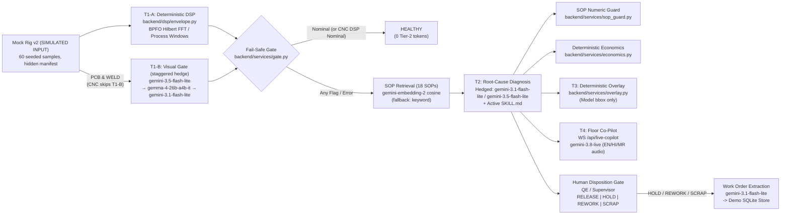

# Vinyas — AI-Assisted Manufacturing Quality & Predictive Maintenance

Vinyas is a multi-modal inspection, SOP-grounded root-cause triage, and multilingual shop-floor co-pilot built for **shop-floor operators and quality engineers** on discrete automotive lines (SMT PCB reflow, CNC spindle machining, and robotic MIG welding).

**Live Cloud Run URL:** https://vinyas-ai-65216244490.asia-south1.run.app

### Try It in 3 Steps (Blind Mode)
1. **Select a line** (`PCB`, `CNC`, or `WELD`) and click **Draw random part** (hidden ground truth; no answer text on frames).
2. Click **Inspect part** to run deterministic DSP + Google AI gating, SOP retrieval, root-cause diagnosis, and model-located bbox overlay.
3. Click **Reveal ground truth** to compare the system's verdict against the hidden manifest, then record a human disposition (`RELEASE / HOLD / REWORK / SCRAP`) and log a multilingual work order.

---

## What Is Real vs Simulated

Per Startup Buildathon India 2026 organiser ruling, physical factory hardware is **not required**. Simulated inputs are permitted when they are physically plausible, leak no answers, and are explicitly labelled.

| Component | Status | Details |
| --- | --- | --- |
| Camera frames, 48 kHz WAV vibration, process telemetry | **SIMULATED INPUT** | Generated deterministically by `backend/mock_rig/` (60 seeded samples, zero text on images, ground truth isolated in `data/mock_rig/manifest.json` which inference never reads). Always badged `SIMULATED INPUT`. |
| Tier-1A Signal & Process Gate | **REAL (Deterministic DSP)** | NumPy/SciPy 2–8 kHz Butterworth bandpass → `\|hilbert\|` envelope → FFT → computed BPFO/2×BPFO SNR, kurtosis, ISO 20816-3 reference zones, SAC305 & MIG process windows (`backend/dsp/envelope.py`). |
| Tier-1B Visual Gate, Retrieval, Tier-2 Diagnosis, Tier-4 Co-Pilot, WO Extraction | **REAL (Google AI API)** | Live `google-genai` SDK calls with per-stage `StageProvenance` naming the exact `model_id`, latency, attempts, and token counts. |
| Tier-3 Visual Repair Overlay | **REAL (Deterministic render of AI bbox)** | Pillow draws a bounding box **only** from the model's returned `bbox` (`0..1000` scaled to actual image dimensions); draws no box when no defect is found. Nano Banana image models are **not** used at runtime (all 4 returned `429 RESOURCE_EXHAUSTED` on this key). |
| Incident, Disposition & Work Order Storage | **DEMO STORE (SQLite)** | Local SQLite (`backend/db/demo_store.py`) — resets when the Cloud Run container restarts. Production PostgreSQL + `pgvector(768)` schema is documented in `infra/alloydb_schema.sql` (not deployed). |
| Machine / PLC Actuation | **NOT BUILT (By Design)** | AI recommends only. A human QE or Supervisor records every disposition. |

---

## Architecture



---

## Google AI Models Used (Verified & Measured)

Each model was chosen by a live benchmark whose decision rule was fixed before the run: the visual gate by [eval/visual_gate_benchmark.md](eval/visual_gate_benchmark.md) and Tier-2 by [eval/model_selection.md](eval/model_selection.md). `gemini-4-hydrogen` scored `0/8` (timeouts/503) in [run 1](eval/model_selection_run1.md) and `gemini-3.8-flash` hit `429` quota on every call in run 2, so neither is routed.

| Role | Exact Model ID | Code Location | Why This Model | Fallback (Labelled) | Measured p50 |
| --- | --- | --- | --- | --- | ---: |
| T1-A Signal Gate | Deterministic DSP (NumPy/SciPy) | `backend/dsp/envelope.py:evaluate_t1a_signal_gate` | Millisecond Hilbert envelope FFT & window checks; an LLM should not run FFTs. | None needed | `0 ms` (p95 `49 ms`) |
| T1-B Visual Gate (PCB & WELD; `SKIPPED` on CNC) | `gemini-3.5-flash-lite` → `gemma-4-26b-a4b-it` → `gemini-3.1-flash-lite` (staggered hedge: next model after 3 s or on failure, 12 s cap) | `backend/services/model_router.py:run_tier1_visual_gate` | Cheap image screen before Tier-2 on optical lines; skipped on CNC (`bearing not visible; vibration-led`) so DSP decides directly. Order chosen by `eval/visual_gate_benchmark.md`. | Fail-safe `ESCALATE` (human review) if all three fail | `1.98 s` (p95 `4.91 s`) |
| SOP Retrieval | `gemini-embedding-2` (`768-D`) | `backend/db/demo_store.py:search_sops` | Real cosine similarity across 18 SOPs (line-scoped to the 6 SOPs for the active line with semantic DSP flag expansion), cached in SQLite. | `KEYWORD FALLBACK` | Measured per request |
| T2 Root-Cause Diagnosis | `gemini-3.1-flash-lite` (primary), hedged with `gemini-3.5-flash-lite` after 5.7 s | `backend/services/model_router.py:run_tier2_multimodal_diagnosis` | Best agreement within the p95 limit in `eval/model_selection.md`; strict Pydantic schema + bbox. | `FALLBACK_RULES` (AI unavailable; no money figure shown) | `3.28 s` (p95 `6.59 s`) |
| T3 Visual Overlay | Deterministic Pillow (model bbox) | `backend/services/overlay.py:render_model_bbox_overlay` | Draws only model-returned bbox + SOP spec on native image resolution. | No box if no bbox / `NO_DEFECT_FOUND` | `205 ms` (p95 `361 ms`) |
| T4 Floor Co-Pilot | `gemini-3.8-live` (WS `/api/live-copilot`) | `backend/services/model_router.py:run_tier4_live_copilot` | spoken question → browser speech-to-text → `gemini-3.8-live` spoken reply in EN / हिन्दी / मराठी for gloved operators. | `gemini-3.1-flash-lite` text + browser voice (`REST /api/copilot/chat`) | `8.58 s` (3/3 live turns) |
| Work-Order Extraction | `gemini-3.1-flash-lite` | `backend/db/demo_store.py:create_work_order` | Extracts `part_code`, `shift_priority`, `required_spares`, `sla_risk` from EN/HI/MR notes. | `FALLBACK_RULES` regex | Measured per WO |

---

## Measured Evaluation Results

> Measured on simulated inputs generated by backend/mock_rig (organiser-approved, no hardware). Not field accuracy.

Full pipeline, **30 parts (10 per line)**, live Cloud Run run (`n=30`, date `2026-11-20`, revision `vinyas-ai-00004-srs`, `google-genai==1.20.0`, `python scripts/eval_pipeline.py --target live --n 30`; full artifact in [eval/live_run_20261120_184801.md](eval/live_run_20261120_184801.md)):

- **Gate:** `10/10` true defects escalated (`100.0%` recall), `20/20` nominal and hard-negative parts cleared (`0.0%` false escalations, `0` false negatives). Ground truths from local manifest: `0/30` (all 30 revealed directly via Cloud Run `/api/rig/reveal`).
- **Who answered T1-B:** `gemini-3.5-flash-lite` `19`, `gemini-3.1-flash-lite` `1`, `SKIPPED (CNC vibration-led)` `10`, `FALLBACK_RULES` `0`.
- **Tier-2 defect type on escalated defects:** `8/10 (80.0%)` — all `10/10` answered live by Gemini (`0` rule-based fallbacks; both misses called insufficient solder a bridge).
- **SOP retrieval:** live `gemini-embedding-2` used `10/10`; correct SOP in top 3 `10/10` (ranked 1st `2/10`); Tier-2 final SOP correct `8/10`.
- **SOP guard:** `0` unverified numeric values in Tier-2 steps.
- **Latency p50 / p95:** DSP `0 / 49 ms`, T1-B visual gate `1,976 / 4,905 ms`, Tier-2 `3,280 / 6,587 ms`, overlay `205 / 361 ms`, end-to-end `3,498 / 9,070 ms` (CNC healthy/wrench-strike parts clear in `~80–90 ms` with T1-B skipped).
- **Token effect of the gate:** `+36.8%` fewer tokens than sending all 30 parts to Tier-2 (`67,599` vs `106,890`; `31,969` T1 tokens + `10 × 3,563` mean Tier-2 tokens; `0` failed Tier-2 calls). Real plant savings depend on the plant's defect rate and live API availability.

Component benchmarks & live smoke verification (decision rules fixed before each run):
- **DSP gate alone, all 60 parts, no API:** `19/21` defects flagged, `0/39` false flags; the 2 misses are PCB defects with in-window reflow telemetry that only the camera can see ([eval/dsp_gate_calibration.md](eval/dsp_gate_calibration.md)).
- **Visual gate, 46 frames in upload mode:** `gemini-3.5-flash-lite` caught `14/14` visible defects with `0/32` false alarms ([eval/visual_gate_benchmark.md](eval/visual_gate_benchmark.md)).
- **Tier-2, 8 defect samples:** `gemini-3.1-flash-lite` and `gemini-3.5-flash-lite` both `6/8`; `gemini-3.8-flash` had no quota ([eval/model_selection.md](eval/model_selection.md)).
- **Live Cloud Run verification (`vinyas-ai-00004-srs`, `google-genai==1.20.0`):** `9/9` blind draws accurate (`p50 = 4.35 s`), `6/6` custom upload checks accurate across PCB/WELD/CNC, `3/3` `gemini-3.8-live` audio turns live in EN/HI/MR (`7.0–10.7 s`), `400 -> 200` disposition gating + live Hindi WO extraction, `/health` `status: "ok"` with `degraded_models: []` ([eval/live_verification.md](eval/live_verification.md)).

---

## Problem, Assumptions & Customer Evidence

- **Physical & economic assumptions:** Every constant (ISO 20816-3:2022 Group 2 zones, representative 7014C-class bearing geometry, SAC305 reflow window, AWS D8.8-style MIG porosity criteria, and unvalidated INR unit/downtime assumptions) is documented in [docs/ASSUMPTIONS.md](docs/ASSUMPTIONS.md).
- **Customer validation:** Not yet done; planned with Tier-2/3 automotive component suppliers in the Pune (Chakan / Bhosari) industrial belt. See [docs/CUSTOMER_EVIDENCE.md](docs/CUSTOMER_EVIDENCE.md).

---

## Competitive Landscape

| Competitor | Neutral Summary | Reference |
| --- | --- | --- |
| **Infinite Uptime** (Pune) | Industrial vibration hardware & predictive maintenance analytics for rotating equipment. | https://www.infinite-uptime.com |
| **Altizon** (Pune) | Industrial IIoT platform (Datonis) for factory telemetry, OEE, and condition monitoring. | https://altizon.com |
| **Tractian** | Wireless vibration/energy sensors paired with predictive maintenance and CMMS software. | https://tractian.com |
| **Augury** | Dedicated machine-health sensors and AI diagnostics for rotating industrial assets. | https://www.augury.com |
| **Nanoprecise** | Cellular IoT vibration/acoustic/temperature sensors for automated rotating-asset diagnostics. | https://nanoprecise.io |
| **Landing AI (LandingLens)** | Domain-specific computer vision platform for visual defect inspection. | https://landing.ai |
| **Google Cloud Visual Inspection AI** | Managed Google Cloud vision models for automated optical assembly inspection. | https://cloud.google.com/solutions/visual-inspection-ai |
| **Siemens Senseye / Industrial Copilot** | Enterprise predictive maintenance analytics and generative shop-floor assistant integrated with Siemens automation. | https://www.sw.siemens.com |

**Built differentiators in Vinyas:**
1. Closed shop-floor loop: multi-modal gating (DSP + vision) → SOP-guarded steps in English, Hindi, or Marathi → mandatory human disposition → multilingual work-order extraction.
2. Transparent per-stage provenance and measured edge-gate token accounting (`POST /api/line-run` and `eval/RESULTS.md`).
3. Multi-modality per line (vibration-led for internal CNC bearings; optical + process telemetry for PCB and MIG weld).

**Honest defensibility:** The prompt templates and UI are easy to copy. Real defensibility over time would come from labelled plant failure-event datasets collected during pilots, plant-specific SOP libraries, and distribution through regional CNC/SMT tooling distributors — none of which exist yet.

---

## Limitations (Honest List)
- **Simulated inputs only:** No physical camera or accelerometer is connected (`backend/mock_rig/`).
- **Easy synthetic defects:** The visual gate caught every visible defect in `eval/visual_gate_benchmark.md`, and the DSP gate separates outer-race faults by ~28 dB. Both are measured on clean procedural frames and signals; real photos and real spindle data will be harder, and no real-image accuracy has been measured.
- **Free-tier availability:** Visual-gate and Tier-2 calls regularly return `503`/`429`. The hedges cut the impact, but when every model fails the part is held for human review (fail-safe), so healthy parts can be held during an outage.
- **Demo SQLite storage:** Incidents, dispositions, and work orders reset whenever Cloud Run restarts a container (`infra/alloydb_schema.sql` is design-only).
- **Image-model quota:** All 4 Nano Banana image models returned `429 RESOURCE_EXHAUSTED` on this key, so generative Tier-3 images are omitted; `gemini-3.8-flash` also had no quota.
- **Voice input browser support:** Web Speech API (`SpeechRecognition`) requires Chrome/Edge; unsupported browsers prompt the operator to type instead.
- **Unvalidated economics & no customer interviews yet:** INR avoidable-loss figures are unvalidated team assumptions (`docs/ASSUMPTIONS.md`).

---

## Roadmap (Future Work — Not Shipped)
- Non-invasive no-PLC retrofit kit (USB accelerometer + industrial camera + on-prem Gemma edge node).
- Managed PostgreSQL / AlloyDB deployment using `infra/alloydb_schema.sql` (`vector(768)`).
- Streaming 16 kHz microphone PCM directly into `gemini-3.8-live` over `/api/live-copilot`.
- Pilot validation with Pune Chakan/Bhosari Tier-2/3 suppliers and tooling-distributor channel.

---

## Optional On-Prem Edge Client (Not Part of Hosted Demo)
`edge_client/edge_gateway.py` demonstrates running `backend/dsp/envelope.py` + a local Ollama Gemma model (`gemma4:e4b`) on an on-prem edge box and escalating only flagged parts to Cloud Run `/api/inspect`. It requires a local Ollama server and is **not** executed in the hosted Cloud Run demo.

---

## Run Locally & Deploy

```bash
# 1. Install dependencies & build frontend
pip install -r requirements.txt
cd frontend && npm ci && npm run build && cd ..

# 2. Run fast offline test suite (~3 s, no API key needed)
pytest -v

# 2b. Reproduce the measurements in eval/ (the last two commands call the Gemini API)
python scripts/calibrate_dsp_gate.py                 # DSP gate vs hidden manifest, no API calls
python scripts/benchmark_visual_gate.py gemma-4-26b-a4b-it,gemini-3.5-flash-lite,gemini-3.1-flash-lite
python scripts/eval_pipeline.py --target local --n 30

# 3. Run locally (set GEMINI_API_KEY in .env)
uvicorn backend.main:app --host 0.0.0.0 --port 8080

# 4. Deploy to Cloud Run (uses Secret Manager `gemini-api-key:latest`)
bash scripts/deploy_cloud_run.sh
```
