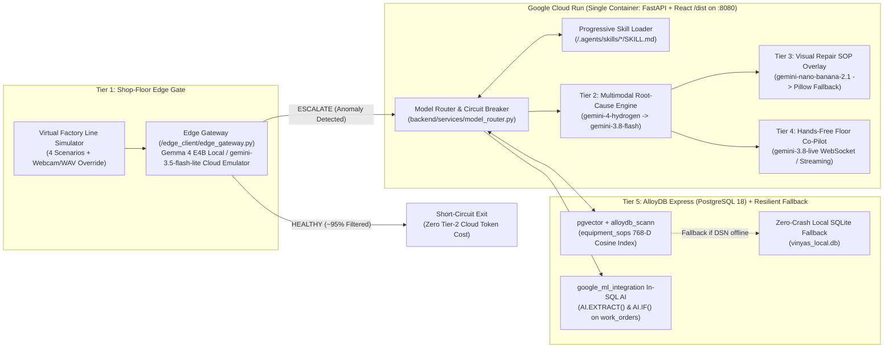

# Vinyas — Manufacturing Quality & Predictive Maintenance Platform
## Architectural & Implementation Blueprint (`implementation_plan.md`)

**Event:** Startup Buildathon India — Pune City Buildathon  
**System:** Vinyas (`Manufacturing Quality & Predictive Maintenance Platform`)  
**Target Deployment:** Single-Container Full-Stack Application on Google Cloud Run (`asia-south1`, port `8080`, `--allow-unauthenticated`)  

---

## 1. Executive Summary & Architectural Vision

Discrete manufacturing facilities across Pune's Chakan, Bhosari, and Pimpri-Chinchwad industrial belts (Tier-2/3 automotive PCB assemblies, CNC spindle machining centers, and MIG robotic weld lines) suffer **4%–9% scrap rates** and unplanned stoppage costs exceeding **₹45,000–₹1,20,000/hour**. Streaming 24/7 high-frame-rate optical and 48 kHz acoustic feeds directly to cloud frontier models is economically unviable and introduces latency spikes.

**Vinyas** solves this with a **5-Tier Edge-to-Cloud Agentic Architecture** backed by **AlloyDB Express (PostgreSQL 18)** with **ScaNN vector indexing**, **in-database SQL AI (`AI.EXTRACT()`, `AI.IF()`)**, **Progressive Disclosure Google Agent Skills (`.agents/skills/`)**, and a **3-Column Industrial Control Room UI**:



---

## 2. Target Repository Structure

```text
/Users/nikhil/Projects/Vinyas/
├── .agents/
│   └── skills/
│       ├── ops-db-guardrails/
│       │   └── SKILL.md
│       ├── pcb-defect-triage/
│       │   ├── SKILL.md
│       │   └── references/
│       │       └── ipc_solder_standards.md
│       ├── bearing-acoustic-diagnostics/
│       │   ├── SKILL.md
│       │   └── references/
│       │       └── vibration_thresholds.md
│       └── maintenance-work-order/
│           ├── SKILL.md
│           └── scripts/
│               └── calc_downtime_cost.py
├── backend/
│   ├── __init__.py
│   ├── main.py                  # FastAPI server (:8080), /health, REST, WebSocket, serves /frontend/dist
│   ├── config.py                # Strict Pydantic Settings (zero hardcoded secrets)
│   ├── schemas.py               # Pydantic v2 models for Inspection, Triage, Diagnosis, WorkOrders, Telemetry
│   ├── db/
│   │   ├── __init__.py
│   │   ├── init_alloydb.sql     # PostgreSQL 18 + vector + alloydb_scann + google_ml_integration + 6 Pune SOPs
│   │   └── alloydb_service.py   # Async PG connector + ScaNN search + AI.EXTRACT/AI.IF + SQLite fallback
│   └── services/
│       ├── __init__.py
│       ├── skill_loader.py      # Progressive Disclosure loader (YAML frontmatter at startup, full body on match)
│       ├── model_router.py      # Official google-genai SDK multi-model router + retries + circuit breaker
│       └── simulator_assets.py  # Serves & auto-generates high-res images + WAV telemetry for 4 scenarios
├── edge_client/
│   └── edge_gateway.py          # Standalone Ollama gemma4:e4b multimodal pre-screener -> POST /api/inspect
├── frontend/
│   ├── package.json             # React 18 + Vite + Tailwind CSS + Lucide React
│   ├── vite.config.js
│   ├── tailwind.config.js
│   ├── postcss.config.js
│   ├── index.html
│   └── src/
│       ├── main.jsx
│       ├── App.jsx              # 3-Column Industrial Control Room + Top Telemetry Bar + Architecture Modal
│       └── index.css
├── tests/
│   ├── __init__.py
│   └── test_vinyas_suite.py
├── Dockerfile                   # Multi-stage: node:20-alpine (/frontend/dist) -> python:3.11-slim (port 8080)
├── .dockerignore
├── .gitignore
├── .env.example
├── requirements.txt
├── implementation_plan.md
├── TODO.md
└── README.md
```
