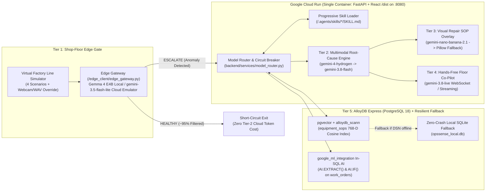

# OpsSense AI — Autonomous Edge-to-Cloud Quality & Maintenance Twin
## Architectural & Implementation Blueprint (`implementation_plan.md`)

**Event:** Startup Buildathon India — Pune City Buildathon  
**System:** OpsSense AI (`Edge-to-Cloud Quality & Maintenance Twin for Discrete Manufacturing`)  
**Target Deployment:** Single-Container Full-Stack Application on Google Cloud Run (`asia-south1`, port `8080`, `--allow-unauthenticated`)  

---

## 1. Executive Summary & Architectural Vision

Discrete manufacturing facilities across Pune's Chakan, Bhosari, and Pimpri-Chinchwad industrial belts (Tier-2/3 automotive PCB assemblies, CNC spindle machining centers, and MIG robotic weld lines) suffer **4%–9% scrap rates** and unplanned stoppage costs exceeding **₹45,000–₹1,20,000/hour**. Streaming 24/7 high-frame-rate optical and 48 kHz acoustic feeds directly to cloud frontier models is economically unviable and introduces latency spikes.

**OpsSense AI** solves this with a **5-Tier Edge-to-Cloud Agentic Architecture** backed by **AlloyDB Express (PostgreSQL 18)** with **ScaNN vector indexing**, **in-database SQL AI (`AI.EXTRACT()`, `AI.IF()`)**, **Progressive Disclosure Google Agent Skills (`.agents/skills/`)**, and a **3-Column Industrial Control Room UI**:



---

## 2. Target Repository Structure

The existing workspace (`/Users/nikhil/Projects/Vinyas`) will be cleanly structured to serve the single-container **OpsSense AI** architecture while preserving reusable synthetic WAVs and reference JPEGs under `/data`:

```text
/Users/nikhil/Projects/Vinyas/
├── .agents/
│   └── skills/
│       ├── ops-db-guardrails/
│       │   └── SKILL.md
│       ├── pcb-defect-triage/
│       │   ├── SKILL.md
│       │   └── references/
│       │       └── ipc_solder_standards.md
│       ├── bearing-acoustic-diagnostics/
│       │   ├── SKILL.md
│       │   └── references/
│       │       └── vibration_thresholds.md
│       └── maintenance-work-order/
│           ├── SKILL.md
│           └── scripts/
│               └── calc_downtime_cost.py
├── backend/
│   ├── __init__.py
│   ├── main.py                  # FastAPI server (:8080), /health, REST, WebSocket, serves /frontend/dist
│   ├── config.py                # Strict Pydantic Settings (zero hardcoded secrets)
│   ├── schemas.py               # Pydantic v2 models for Inspection, Triage, Diagnosis, WorkOrders, Telemetry
│   ├── db/
│   │   ├── __init__.py
│   │   ├── init_alloydb.sql     # PostgreSQL 18 + vector + alloydb_scann + google_ml_integration + 6 Pune SOPs
│   │   └── alloydb_service.py   # Async PG connector + ScaNN search + AI.EXTRACT/AI.IF + SQLite fallback
│   └── services/
│       ├── __init__.py
│       ├── skill_loader.py      # Progressive Disclosure loader (YAML frontmatter at startup, full body on match)
│       ├── model_router.py      # Official google-genai SDK multi-model router + retries + circuit breaker
│       └── simulator_assets.py  # Serves & auto-generates high-res images + WAV telemetry for 4 scenarios
├── edge_client/
│   └── edge_gateway.py          # Standalone Ollama gemma4:e4b multimodal pre-screener -> POST /api/inspect
├── frontend/
│   ├── package.json             # React 18 + Vite + Tailwind CSS + Lucide React
│   ├── vite.config.js
│   ├── tailwind.config.js
│   ├── postcss.config.js
│   ├── index.html
│   └── src/
│       ├── main.jsx
│       ├── App.jsx              # 3-Column Industrial Control Room + Top Telemetry Bar + Architecture Modal
│       ├── index.css
│       └── components/
│           ├── TelemetryHeader.jsx
│           ├── ArchitectureModal.jsx
│           ├── FactorySimulatorColumn.jsx
│           ├── AgenticPipelineColumn.jsx
│           └── CopilotAndLedgerColumn.jsx
├── tests/
│   ├── __init__.py
│   ├── test_health_and_schemas.py
│   ├── test_skill_loader_and_guardrails.py
│   └── test_pipeline_and_circuit_breakers.py
├── Dockerfile                   # Multi-stage: node:20-alpine (/frontend/dist) -> python:3.11-slim (port 8080)
├── .dockerignore
├── .gitignore
├── .env.example
├── requirements.txt
├── implementation_plan.md
├── TODO.md
└── README.md
```

---

## 3. Google Agent Skills (`.agents/skills/`) & Progressive Disclosure

Compliant with the `agentskills.io` specification:
- Frontmatter contains `name` (lowercase-kebab-case, `<= 64` chars, matching folder name) and `description` (`< 1024` chars with explicit domain trigger rules).
- Each `SKILL.md` is strictly `< 500` lines.
- **Progressive Disclosure in `backend/services/skill_loader.py`:**
  1. **Startup Index (`list_skill_metadata()`):** Parses only YAML frontmatter (`name`, `description`, `path`) into memory (~120 tokens total).
  2. **On-Demand Activation (`load_skill_for_domain(scenario_key, defect_hint)`):** Loads full `SKILL.md` markdown body and attached `references/*.md` or executes `scripts/calc_downtime_cost.py` only when an escalated anomaly matches that skill's trigger rule.

| Skill Directory | Trigger Condition | Attached Resources |
| :--- | :--- | :--- |
| `ops-db-guardrails` | Always enforced on DDL/DML inspection & query validation | Regex rules enforcing `snake_case`, primary key `id`, parameterized `$1`/`?` binds, blocking `DROP TABLE` / raw f-string SQL |
| `pcb-defect-triage` | Scenario 1 (`LINE_A_PCB`) or optical PCB solder/component anomaly | `references/ipc_solder_standards.md` (IPC-A-610 Class 3 automotive reflow bridge & tombstoning limits) |
| `bearing-acoustic-diagnostics` | Scenario 2 (`LINE_B_CNC`) or acoustic/vibration spindle anomaly | `references/vibration_thresholds.md` (ISO-10816-3 Class II CNC spindle BPFO/BPFI harmonic thresholds) |
| `maintenance-work-order` | Work order enrichment & downtime/scrap financial estimation | `scripts/calc_downtime_cost.py` (Deterministic INR scrap & stoppage cost calculator for Pune Tier-2/3 lines) |

---

## 4. AlloyDB Express (PostgreSQL 18) Schema, ScaNN & In-SQL AI

### 4.1 DDL (`backend/db/init_alloydb.sql`)
Follows `ops-db-guardrails`:
1. **Extensions:**
   ```sql
   CREATE EXTENSION IF NOT EXISTS vector;
   DO $$ BEGIN
       CREATE EXTENSION IF NOT EXISTS alloydb_scann;
   EXCEPTION WHEN OTHERS THEN
       RAISE NOTICE 'alloydb_scann not available on this host, falling back to standard pgvector index';
   END $$;
   DO $$ BEGIN
       CREATE EXTENSION IF NOT EXISTS google_ml_integration;
   EXCEPTION WHEN OTHERS THEN
       RAISE NOTICE 'google_ml_integration not active, Python fallback enabled for AI.EXTRACT / AI.IF';
   END $$;
   ```
2. **Tables (`snake_case`, mandatory primary key `id`):**
   - `equipment_sops`:
     - `id TEXT PRIMARY KEY` (e.g., `'SOP-PUNE-PCB-01'`)
     - `machine_type TEXT NOT NULL`
     - `fault_code TEXT NOT NULL`
     - `title TEXT NOT NULL`
     - `sop_markdown TEXT NOT NULL`
     - `torque_spec TEXT NOT NULL`
     - `embedding vector(768) NOT NULL`
   - `inspection_incidents`:
     - `id TEXT PRIMARY KEY`
     - `scenario_key TEXT NOT NULL`
     - `line_name TEXT NOT NULL`
     - `tier1_status TEXT NOT NULL`
     - `defect_class TEXT NOT NULL`
     - `severity TEXT NOT NULL`
     - `root_cause TEXT NOT NULL`
     - `scrap_saved_inr INTEGER NOT NULL`
     - `inference_mode TEXT NOT NULL`
     - `latency_ms INTEGER NOT NULL`
     - `created_at TIMESTAMPTZ NOT NULL DEFAULT NOW()`
   - `work_orders`:
     - `id TEXT PRIMARY KEY`
     - `incident_id TEXT NOT NULL REFERENCES inspection_incidents(id)`
     - `machine_id TEXT NOT NULL`
     - `operator_notes TEXT NOT NULL`
     - `extracted_tags_json JSONB NOT NULL`
     - `sla_critical_flag BOOLEAN NOT NULL DEFAULT FALSE`
     - `db_ai_mode TEXT NOT NULL DEFAULT 'ALLOYDB_IN_SQL'`
     - `status TEXT NOT NULL DEFAULT 'OPEN'`
     - `created_at TIMESTAMPTZ NOT NULL DEFAULT NOW()`
3. **ScaNN Index:**
   ```sql
   DO $$ BEGIN
       EXECUTE 'CREATE INDEX IF NOT EXISTS equipment_sops_scann_idx ON equipment_sops USING scann (embedding cosine) WITH (num_leaves=16)';
   EXCEPTION WHEN OTHERS THEN
       RAISE NOTICE 'ScaNN index creation skipped; using cosine distance operator <=> directly';
   END $$;
   ```
4. **Seed Data:** 6 realistic Pune automotive manufacturing SOPs (1. SMT Reflow Fine-Pitch QFP Solder Bridge IPC-A-610, 2. Makino/Haas CNC Spindle Bearing Outer-Race Spall ISO-10816, 3. Robotic MIG Chassis Subframe Weld Porosity & Shielding Gas Drift, 4. Laser Seam Calibration Baseline Nominal Reference, 5. Hydraulic Press Brake Proportional Valve Drift, 6. BGA Thermal Voiding X-Ray Profile) seeded with deterministic normalized 768-D embeddings.

### 4.2 In-Database SQL AI (`AI.EXTRACT()` & `AI.IF()`) + Dual Fallback
When `POST /api/work-orders` is invoked:
1. **Primary AlloyDB In-SQL Execution:**
   ```sql
   SELECT
     ai.extract(
       $1::text,
       ARRAY['part_code', 'shift_priority', 'required_spares']
     ) AS extracted_tags,
     ai.if(
       'Does this maintenance note describe an urgent production line stoppage, safety risk, or critical OEM SLA breach? Note: ' || $1::text
     ) AS sla_critical_flag;
   ```
2. **Graceful Python Fallback (`PYTHON_FALLBACK`):** If `google_ml_integration` is disabled on the instance or local SQLite fallback is active, `alloydb_service.py` catches the SQL exception and executes a fast structured Gemini / deterministic extraction returning identical JSON (`{"part_code": ..., "shift_priority": ..., "required_spares": ...}`) and boolean `sla_critical_flag`, labeling `"db_ai_mode": "ALLOYDB_IN_SQL" | "PYTHON_FALLBACK"`.

---

## 5. Multi-Model Google AI Orchestration (`backend/services/model_router.py`)

| Tier | Component | Primary Model ID | Fallback / Circuit Breaker | Engineering Justification |
| :--- | :--- | :--- | :--- | :--- |
| **Tier 1** | Edge Anomaly Gate | `gemma4:e4b` (Edge Client) / `gemini-3.5-flash-lite` (Cloud Sandbox Emulator) | `gemini-2.5-flash-lite` -> Deterministic Sensor Threshold Gate | Pre-screens 100% of frames/audio in `<120 ms`. Short-circuits Scenario 4 (`HEALTHY`), preventing ~95% of Tier-2 cloud token spend. |
| **Tier 2** | Multimodal Root-Cause & ScaNN RAG | `gemini-4-hydrogen` | `gemini-3.8-flash` -> `gemini-2.5-flash` -> Cached JSON Circuit Breaker | Triggered **only** on `ESCALATE`. Fuses defect image + acoustic spectrum metrics + AlloyDB ScaNN top-3 SOPs + active `SKILL.md` into strict Pydantic JSON. |
| **Tier 3** | Visual Repair SOP Overlay | `gemini-nano-banana-2.1` | `gemini-2.5-flash-image-preview` -> High-Contrast Pillow Callout Renderer | Generates a visual repair overlay card directly on the defect photo with bounding callouts, torque specs, and SynthID provenance badge. |
| **Tier 4** | Hands-Free Technician Co-Pilot | `gemini-3.8-live` | `gemini-3.8-flash` / `gemini-2.5-flash` streaming -> Grounded SOP Response | WebSocket (`/api/live-copilot`) + REST streaming endpoint allowing technicians on the shop floor to ask hands-free voice/quick-chip questions grounded in the active incident and ScaNN SOP. |
| **Tier 5** | In-DB Work Order Enrichment | AlloyDB `AI.EXTRACT()` + `AI.IF()` | Gemini structured extraction / deterministic parser | Extracts spare part codes, shift priority, and OEM SLA breach flags directly inside PostgreSQL 18 on ticket creation without external ETL. |

---

## 6. REST & WebSocket API Contracts (`backend/main.py`)

- `GET /health`
  - Returns HTTP 200:
    ```json
    {
      "status": "ok",
      "service": "OpsSense AI // Edge-to-Cloud Quality Twin",
      "cloud_run_ready": true,
      "storage_mode": "ALLOYDB_EXPRESS_SCANN | LOCAL_SQLITE_FALLBACK",
      "db_ai_mode": "ALLOYDB_IN_SQL | PYTHON_FALLBACK",
      "inference_mode": "LIVE_GOOGLE_AI | CACHED_FALLBACK",
      "loaded_skills_count": 4,
      "models": {
        "tier1_edge_emulator": "gemini-3.5-flash-lite",
        "tier1_physical_edge": "gemma4:e4b",
        "tier2_primary": "gemini-4-hydrogen",
        "tier2_fallback": "gemini-3.8-flash",
        "tier3_visual_sop": "gemini-nano-banana-2.1",
        "tier4_live_copilot": "gemini-3.8-live",
        "tier5_db_ai": "AlloyDB AI.EXTRACT() + AI.IF()"
      }
    }
    ```
- `GET /api/scenarios` — Returns the 4 Virtual Factory Line Simulator scenarios with sensor telemetry, preview image URLs, and audio stream URL for Line B.
- `GET /api/skills` — Returns progressive disclosure metadata (`name`, `description`, `loaded_full_body: bool`, `trigger_count: int`).
- `POST /api/inspect` — Executes the end-to-end pipeline:
  - Input: `InspectionRequest` (`scenario_key`, optional `custom_image_base64`, `sensor_telemetry`, `force_edge_only`).
  - Step 1: Tier-1 Edge Gate (`gemini-3.5-flash-lite`). If `scenario_key == "LINE_D_HEALTHY"` (Scenario 4), returns `pass_status = "HEALTHY"` immediately with `tier2_diagnosis = null`, `tier3_visual_sop_base64 = null`, and `tokens_saved_pct = 95.4`.
  - Step 2 (if `ESCALATE`): Activates matching `.agents/skills/<skill>/SKILL.md` + `references/` and queries AlloyDB ScaNN top-3 SOPs (`equipment_sops`).
  - Step 3: Calls Tier-2 Multimodal Diagnosis (`gemini-4-hydrogen` -> `gemini-3.8-flash` fallback -> circuit breaker).
  - Step 4: Calls Tier-3 Visual Repair Overlay (`gemini-nano-banana-2.1` -> Pillow annotated blueprint overlay fallback).
  - Step 5: Persists incident to `inspection_incidents` and returns full telemetry & stage latencies (`tier1_ms`, `scann_rag_ms`, `tier2_ms`, `tier3_ms`).
- `POST /api/work-orders` — Creates a maintenance work order in `work_orders` using AlloyDB `AI.EXTRACT()` and `AI.IF()` (with automatic Python fallback).
- `GET /api/work-orders` — Lists persisted work orders and cumulative INR scrap saved across browser refreshes.
- `POST /api/copilot/chat` & `WS /api/live-copilot` — Hands-free floor technician Co-Pilot grounded in the active incident + AlloyDB SOP.

---

## 7. Sequential Gate Verification Plan

1. **Plan Gate (Current):** Inspect workspace & tools, write `implementation_plan.md` and `TODO.md`, and pause for user confirmation of `GOOGLE_CLOUD_PROJECT`, `ALLOYDB_DSN` (or IAM connection details), and `GEMINI_API_KEY`.
2. **Step 1 Gate (Database, Agent Skills & Backend Core):**
   - Implement `.agents/skills/*`, `backend/db/init_alloydb.sql`, `backend/db/alloydb_service.py`, `backend/config.py`, `backend/schemas.py`, `backend/services/skill_loader.py`, `backend/services/model_router.py`, `backend/services/simulator_assets.py`, `backend/main.py`, `/edge_client/edge_gateway.py`, and `/tests/*`.
   - Verification: Run `pytest -v` and confirm 100% pass rate across health, schemas, progressive disclosure, SQL guardrails, Scenario 4 short-circuit, and circuit breakers.
3. **Step 2 Gate (Frontend Control Room & Virtual Factory Simulator):**
   - Build the React + Vite + Tailwind CSS 3-column industrial control room under `/frontend`.
   - Verification: Run `npm install && npm run build` inside `/frontend` and verify `/frontend/dist` compiles with zero errors.
4. **Step 3 Gate (Single-Container Docker & Cloud Run Deployment):**
   - Build multi-stage `Dockerfile` combining `/frontend/dist` and FastAPI on port `8080`.
   - Test locally across all 4 scenarios and deploy to Google Cloud Run (`--allow-unauthenticated`).
   - Verification: Verify live `*.run.app/health` returns HTTP 200 and all 4 scenarios operate end-to-end.
5. **Step 4 Gate (Hardening, Security & AI-Evaluation Docs):**
   - Audit `.gitignore` and `.dockerignore` to guarantee zero leaked `.env` or service account keys.
   - Generate final AI-Evaluation-ready `README.md` with Mermaid architecture diagram, Model Justification Matrix, and deployment commands.
